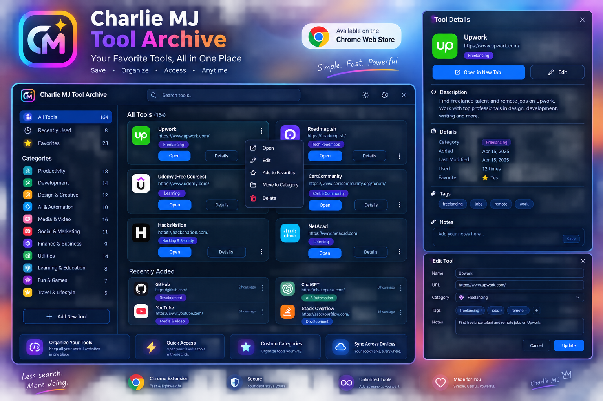

# ✨ Charlie MJ Tool Archive v6.2.0

**Staging Queue + Verified Category Database Edition**

A **Manifest V3 Chrome extension** for organizing a large personal collection of websites, online tools, learning resources, AI services, developer utilities, social-media tools, productivity resources and other bookmarks. It is **local-first**: your library lives in your own Chrome profile, works offline, and can optionally be mirrored to real JSON files that travel with the extension folder.

<p align="center">
  
</p>

## Download

<p align="center">
  <a href="/downloads/charlie-mj-tool-archive-v6_2_1-smart-search.zip">
    
  </a>
</p>

---

## Contents

1. [What's new in v6.2.0](#whats-new-in-v620)
2. [Feature overview](#feature-overview)
3. [Install / upgrade](#install--upgrade)
4. [Database architecture](#database-architecture)
5. [Staging queue and migration](#staging-queue-and-migration)
6. [Where to find the controls](#where-to-find-the-controls)
7. [Moving your library to another PC](#moving-your-library-to-another-pc)
8. [Local, Remote and Unified libraries](#local-remote-and-unified-libraries)
9. [Smart library features](#smart-library-features)
10. [Backup, export and import](#backup-export-and-import)
11. [Native Messaging helper (optional)](#native-messaging-helper-optional)
12. [Project structure](#project-structure)
13. [Permissions](#permissions)
14. [Keyboard shortcuts and Omnibox](#keyboard-shortcuts-and-omnibox)
15. [Known limitations](#known-limitations)
16. [Documentation](#documentation)
17. [Version history](#version-history)
18. [License](#license)

---

## What's new in v6.2.0

| Area | Change |
| --- | --- |
| **Staging queue** | Every manual add, JSON/bookmark import and right-click save is first written to a durable staging queue, then validated, de-duplicated, categorized, saved and **verified before the staging record is removed**. Failed records stay recoverable. |
| **Verified writes** | Every file written to `user-data/` is read back (browser folder) or SHA-256 hashed (native helper) and compared. A save is only reported as verified when every file matches. |
| **Category files by stable ID** | `user-data/database/categories/<categoryId>.json` (nested categories in `database/subcategories/`). Renaming a category never breaks its file. New categories get a file automatically; later tools join the same file. |
| **Index + manifest** | `category-index.json` (ID, path, record count, size, SHA-256) and `database-manifest.json` (totals, default vs personal split, per-file hashes). |
| **Packaged defaults split** | The 330 default tools now live only in `data/database/categories/*.json` (71 category files). `data/default-tools.json` is just a small pointer file. |
| **Recovery loading** | If `profile-data.json` is missing or corrupt the library is rebuilt from the category files, then from `backups/latest-backup.json`. Sources are merged by URL (newest record wins) and conflicts are counted. |
| **Database Manager upgrades** | Migration Manager, Transfer Readiness Check, Database Files table (records / size / integrity), Reconcile Databases, maintenance interval. |
| **Settings integration** | *Settings → Database & Storage → Database & Portable Manager* embeds the complete manager. |
| **Safety backups** | Automatic backup before a migration batch (`pre-migration-*`) and a safety copy before a first write could shrink an existing portable database (`pre-overwrite-*`). Newest 15 dated backups are kept. |
| **GitHub sync** | Syncs the repository's `data/database/` directory (manifest + all category JSON files) as the primary database and shows total tools and category files; flat `default-tools.json` is only a fallback. *Prepare GitHub Database Update* exports your local library as a ready-to-commit `data/` folder. |
| **Native helper 2.0** | Adds `hashFiles`, `listFiles` and `removeFile`. The previous helper still works. |

Everything from earlier versions remains: dashboard, favorites, notes, categories, collections, Settings Center, omnibox, GitHub sync and the Local / Remote library separation.

---

## Feature overview

* 🏠 **Local Library**, ☁️ **Remote GitHub Library** and 🔗 **Unified Library** with source badges
* 🔄 GitHub synchronization with sync history and remote-deletion protection
* ⇄ Local vs Remote comparison and ＋ *Create Local Copy*
* 🗄️ **Central Database Manager** with independent category collections
* 🗂 **Staging & Migration Manager** and 🚚 **Transfer Readiness Check**
* 🌳 Hierarchical categories and subcategories with stable IDs
* 🔎 Smart search across names, URLs, descriptions, categories, tags, aliases and generated labels; `cmj` Chrome Omnibox keyword
* 🧹 Exact-duplicate protection, URL similarity analysis and cleanup
* 📚 Smart Collections and ⌘ Command Center (Ctrl+Shift+P)
* 🧠 Smart tags, similar-tool detection, bulk actions, import preview
* 🩺 Library Health and manual Website Health Checker
* 💾 JSON / ZIP / CSV / detailed-HTML backup and export
* 📁 Optional portable `user-data/` database for copying between PCs
* ⚙️ Dedicated Settings Center, themes (System / Light / Dark) and grid density
* 🖱️ Right-click "Save to Charlie MJ Tool Archive"

---

## Install / upgrade

1. Extract the ZIP to a **new** folder (do not overwrite your existing project folder).
2. Open `chrome://extensions` and enable **Developer mode**.
3. If you are upgrading an installed copy, export a full JSON backup first (Settings → Backup).
4. Choose **Load unpacked** and select the extracted `charlie-mj-tool-archive` folder (the one containing `manifest.json`). If you are replacing the folder of an already-loaded copy, click **Reload** instead.
5. Open the extension dashboard and let the one-time initialization finish.
6. Test: add a tool, import a small JSON, run a GitHub sync, try `cmj` + Space in the address bar.

> Your personal library is stored in the Chrome profile (`chrome.storage.local` + IndexedDB). Removing the extension from Chrome can delete that storage, so make a backup, or connect the portable folder, before uninstalling.

---

## Database architecture

```text
 Add / Import / Right-click
            │
            ▼
┌─────────────────────────────────────────────┐
│ LAYER 1 · STAGING (temporary)               │
│ chrome.storage.local  cmjStagingQueueV1     │
│ mirrored to user-data/staging/              │
│            pending-tools.json               │
└──────────────┬──────────────────────────────┘
   validate · normalize · de-duplicate · categorize
               │  write → read back → verify
               ▼
┌─────────────────────────────────────────────┐
│ LAYER 2 · PRIMARY CATEGORY DATABASE         │
│ IndexedDB category collections              │
│ + one JSON file per category                │
│   • packaged defaults (read-only):          │
│     data/database/categories/*.json         │
│   • personal (written by the extension):    │
│     user-data/database/categories/<id>.json │
└──────────────┬──────────────────────────────┘
               ▼
┌─────────────────────────────────────────────┐
│ LAYER 3 · PORTABLE PROFILE (user-data/)     │
│ profile-data.json · category files · index  │
│ manifest · collections · staging · backups  │
└─────────────────────────────────────────────┘
```

**Three sources, kept distinguishable**

| Source | Where it lives | Writable? |
| --- | --- | --- |
| Packaged defaults (330 tools / 71 categories) | `data/database/categories/*.json` | No — read-only package files |
| Personal local tools | IndexedDB + Chrome Storage, mirrored to `user-data/` | Yes |
| GitHub remote tools | cached copy of the repo's `data/database/` directory | Only through sync; never overwrites personal records |

The manifest records `defaultToolCount` and `personalToolCount`; the library still displays everything together. GitHub updates never overwrite personal local data.

### `user-data/` layout (written by the extension)

```text
user-data/
├── profile-data.json                    full transferable profile
├── database/
│   ├── categories/<categoryId>.json     one file per top-level category
│   ├── subcategories/<id>.json          one file per nested category
│   ├── category-index.json              id → path, records, size, SHA-256
│   ├── database-manifest.json           totals + per-file hashes
│   ├── collections.json
│   └── legacy-local-library.json        v5 compatibility copy
├── staging/
│   └── pending-tools.json               durable staging queue mirror
└── backups/
    ├── latest-backup.json
    ├── profile-… / pre-migration-… / pre-overwrite-….json
```

Chrome extensions cannot silently modify their own installed files, so these files are written to the extension folder only after **you authorize that folder** (File System Access API) and/or through the optional native helper.

---

## Staging queue and migration

When you click **Add** for one tool, or confirm a **JSON / bookmark import** for many, or use the **right-click** save:

1. **Stage** – the record is saved to the durable queue immediately (survives Chrome closing).
2. **Validate** – a valid `http(s)` URL and a name are required (the name defaults to the site's host).
3. **Normalize and de-duplicate** – exact canonical-URL duplicates are skipped.
4. **Categorize** – the stable category ID is assigned; a new category (and its file) is created if needed.
5. **Write** – IndexedDB and the category JSON file are updated; index, manifest and profile are refreshed.
6. **Verify** – the data is read back and compared.
7. **Remove from queue** – only after verification. Failed records remain in the queue and can be retried.

Migration normally takes about a second; there is no waiting period. If the portable folder write cannot be verified (for example folder permission was revoked), the tool is still safe in IndexedDB and stays in the queue as *verifying* until a later retry succeeds.

**Maintenance / reconciliation.** Besides migrating, the extension can compare Chrome Storage, IndexedDB and the portable JSON files and repair differences. Interval options: **15 minutes (default), 30 minutes, 1 hour, 6 hours, daily.** The timer runs while a dashboard tab is open; saves themselves happen immediately.

---

## Where to find the controls

* **Dashboard → Database Manager**
  * **Staging & Migration Manager** – pending / verifying / failed / migrated / duplicate counters, *Process Pending Now*, *Retry Failed*, *Discard Failed*, *Reconcile Databases*, maintenance interval, recent migration log.
  * **Transfer Readiness & Database Files** – *Run Transfer Readiness Check*, per-category file table (records, size, integrity).
  * **Portable Database** – choose the extension folder, native helper path / test, sync now, integrity check, restore.
  * Category tree, collections, category JSON export/import, ZIP backup/restore.
* **Settings → Database & Storage → Database & Portable Manager** – the complete manager embedded inside Settings, plus the *Automatically synchronize portable JSON files* and *Allow browser-folder fallback* switches and an *Open Database & Portable Manager* button for the full-page version.

---

## Moving your library to another PC

Copying an extension folder does **not** copy Chrome's private storage. What travels is whatever the extension has written into `user-data/`.

**On PC1**

1. Open *Database Manager → Portable Database → Select Extension Folder for Transfer* and choose the exact unpacked extension folder (the one containing `manifest.json`). Grant write permission.
2. Click **Run Transfer Readiness Check**. It does a full verified rewrite and checks that:
   * the staging queue is empty,
   * every file was written and verified by read-back,
   * `profile-data.json` and the category files both hold all tools,
   * the category index and manifest match your categories and counts,
   * there are no missing, corrupt or duplicate records.
3. Only when it reports **"Ready to transfer"** (with your tool and category counts) copy the whole extension folder.

**On PC2**

1. Chrome → `chrome://extensions` → Developer mode → **Load unpacked** → select the copied folder.
2. Open the dashboard. It reads `user-data/` (profile → category files → latest backup), merges it with the packaged defaults by URL without creating duplicates, and re-queues anything still pending.
3. To keep writing on PC2, select the PC2 extension folder in Database Manager (or install the native helper there).

A safety net: the first write of a session never silently shrinks an existing portable database; a `pre-overwrite-*` backup is saved first.

If the extension was removed from Chrome on PC1 before any backup or portable sync existed, the personal tools cannot be reconstructed from the package. Recover them from a JSON/ZIP backup or another browser profile.

---

## Local, Remote and Unified libraries

```text
 data/database/categories/*.json        GitHub  data/default-tools.json
 (packaged defaults, via manifest)        (remote library)
                │                                   │
                ▼                                   ▼
          🏠 LOCAL LIBRARY                  ☁️ REMOTE LIBRARY (cached)
                └──────────────┬──────────────────┘
                               ▼
                       🔗 UNIFIED LIBRARY
```

* **Badges:** `🏠 LOCAL`, `☁️ REMOTE`, `🏠 LOCAL + ☁️ REMOTE` (the same site is shown as one card).
* **Filters:** All · Local · Remote · Local + Remote.
* **Comparison:** Local only / Remote only / both / remote changes.
* **Sync:** automatic at startup and on an interval (15 min, 30 min, 1 h, 6 h, daily, or off) or manually (*Settings → Sync from GitHub Now*). Recent activity is recorded in Sync History.
* **Remote deletion protection:** removing a site from GitHub never deletes your local record.
* **Create Local Copy:** turn a remote-only tool into your own customizable local record.
* **The `data/database/` directory is the primary remote database.** Sync reads `data/database/database-manifest.json` and every category JSON file it lists (an older repo layout with `backup-manifest.json` is understood too) and shows the total tool count and category-file count in the sync status. `data/default-tools.json` is only a small pointer; a flat `default-tools.json` that still contains a `tools` array is used only as a fallback when the directory is unavailable. An incomplete download (fewer tools than the manifest says) is rejected instead of partially syncing.
* **Publishing your local tools to GitHub:** the extension only *reads* GitHub; it cannot push without credentials. Use **Prepare GitHub Database Update** (Dashboard → Settings & Library Tools, or Settings → Backup / GitHub Sync) to download `charlie-mj-tool-archive-github-data-update.zip`. It contains `data/database/` (category files, index, manifest, config) and the pointer `data/default-tools.json`, with private notes, favorites and usage history removed. Delete the old `data/database/categories` and `subcategories` folders in your repo, copy the ZIP's `data` folder over it, commit and push, then click **Sync from GitHub Now**.

Personal data (favorites, notes, usage history, local overrides) is kept separate and is not blindly overwritten by remote sync.

---

## Smart library features

* **Smart Add Tool** – duplicate warning, URL normalization, category autocomplete with counts, smart tag suggestions, similar-tool warning, description and personal notes.
* **Category Manager** – create, rename, merge, delete, reassign, view counts; hierarchical categories with stable IDs.
* **Advanced search** – `category:`, `tag:`, `favorite:true`, `type:`, `used:recent`, combinable with source filters.
* **Duplicate protection** – URL comparison keeps meaningful path case and query parameters, and ignores fragments, a leading `www.`, default ports and trailing slashes. Only exact canonical matches are blocked; similar URLs stay reviewable. Similarity percentages are advisory.
* **Bulk actions** – move category, add tags, favorite, export, remove.
* **Import preview** – new / existing / duplicate / similar / missing-category analysis for JSON and Chrome bookmark HTML.
* **Library Health** – totals, categories, duplicates, missing descriptions, uncategorized, invalid URLs, never-used tools.
* **Website Health Checker** – manual; a blocked or failed automated check does not always mean a site is down.
* **Favorites, Recently Used, usage statistics.**
* **Smart Collections** and **Command Center** (Ctrl+Shift+P).
* **Tool revision snapshots** are retained in local storage (a dedicated revision browser is a future enhancement).

---

## Backup, export and import

* Full JSON backup / restore, per-category JSON export/import, ZIP backup/restore (one JSON per category plus index/config/manifest).
* CSV export and detailed offline HTML export (name, URL, category, type, description, tags, notes, favorite, dates, usage, source).
* JSON import, Chrome bookmark import and import preview. **JSON and bookmark imports go through the staging queue.**
* Restore bundled defaults (loaded from the packaged category files).
* Portable folder backups under `user-data/backups/`.

---

## Native Messaging helper (optional)

The browser-folder method needs no extra software. The helper adds file writing without Chrome's folder permission prompts, and is useful for advanced setups.

* Python script and Windows installer/build scripts are in `native-messaging/` (see its README).
* Helper **2.0** supports `writeFile`, `readFile`, `hashFiles` (SHA-256 verification), `listFiles`, `removeFile` (limited to `database/`, `backups/` and `staging/`) and `inspect`.
* Rebuild the Windows executable with `build-native-host.ps1` to get the new actions. An older helper still works; the extension falls back to reading files back for verification.
* Install the helper on each PC and set its data path to that PC's extension `user-data` folder.

---

## Project structure

```text
charlie-mj-tool-archive/
├── manifest.json
├── VERSION
├── data/
│   ├── default-tools.json                 small pointer (no tools inside)
│   └── database/
│       ├── database-config.json
│       ├── category-index.json
│       ├── database-manifest.json
│       ├── categories/*.json              71 packaged default category files (330 tools)
│       └── subcategories/
├── user-data/                             written by the extension; copy this with the folder
│   ├── profile-data.json
│   ├── database/  staging/  backups/
├── src/
│   ├── background.js                      sync, context menu, default-library loader
│   ├── dashboard.html / dashboard.js      main UI, Database Manager, staging driver
│   ├── staging-engine.js                  durable queue, migration, reconciliation
│   ├── portable-sync.js                   verified portable writes, recovery, readiness
│   ├── database-engine.js                 IndexedDB category collections
│   ├── advanced.js                        categories, search, similarity, metadata
│   ├── zip-manager.js                     ZIP backup / restore
│   ├── settings.html / settings.js / settings.css   Settings Center
│   └── styles.css
├── native-messaging/                      optional helper (+ Windows scripts)
├── scripts/build-default-manifest.py      rebuild index / manifest / pointer after editing defaults
├── docs/
├── icons/  assets/
├── LICENSE
└── README.md
```

After editing any file in `data/database/categories/`, run:

```text
python scripts/build-default-manifest.py
```

---

## Permissions

```text
storage, bookmarks, tabs, contextMenus, alarms, nativeMessaging
```

Host permissions (`https://raw.githubusercontent.com/*`, `http://*/*`, `https://*/*`) are used for reading the public GitHub library and the manual website health check. No GitHub login is required to read a public default library. Folder access is granted by you through Chrome's folder picker and can be revoked at any time.

---

## Keyboard shortcuts and Omnibox

| Shortcut | Action |
| --- | --- |
| `Ctrl + Shift + L` | Open Charlie MJ Tool Archive (customizable at `chrome://extensions/shortcuts`) |
| `Ctrl + K` | Focus the search field |
| `Ctrl + Shift + P` | Command Center |
| `cmj` + Space | Search the archive from Chrome's address bar |

Chrome does not allow extensions to intercept ordinary address-bar typing; the supported `cmj` keyword provider is used.

---

## Known limitations

* The portable files are written only after you authorize the extension folder (or install the native helper). Chrome may ask you to re-approve folder access after a restart; until then new tools stay safely in the staging queue.
* The maintenance/reconciliation timer runs only while a dashboard tab is open.
* Chrome's own storage (`chrome.storage`, IndexedDB) is never copied with the folder; only what the extension wrote into `user-data/` travels.
* Packaged files under `data/` are read-only at runtime.
* The extension cannot push to GitHub by itself; publishing is export → commit → push.
* There is currently no "migrate only after X minutes" delay and no manual-only migration mode; migration runs right after each add or import, and *Process Pending Now* handles anything left in the queue.
* The planned *Available Tools* tab, extra Settings tabs (Staging Queue, Category File Database, Local & Remote Sync, Automation, Logs) and selective "move selected to local" controls are not part of v6.2.0.

---

## Documentation

| Document | Topic |
| --- | --- |
| `docs/CHANGELOG-V6.2.0.md` | What changed in v6.2.0 |
| `docs/STAGING-AND-CATEGORY-DATABASE-V6.2.0.md` | Staging flow, layers, transfer procedure |
| `docs/TRANSFER-AND-SETTINGS-HOTFIX-V6.1.3.md`, `docs/BUNDLED-PROFILE-TRANSFER-V6.1.2.md` | Earlier transfer notes |
| `docs/PORTABLE-DATABASE-V6.1.0.md`, `docs/PORTABLE-DATABASE-V6.1.1.md` | Portable database history |
| `docs/DATABASE-FORMAT-V6.md`, `docs/DATABASE-FORMAT-V6.0.1.md`, `docs/DATA-FORMAT.md` | Data formats |
| `docs/SETTINGS-CENTER-V6.0.2.md` | Settings Center |
| `docs/V6.0.0-ADVANCED-FEATURES.md`, `docs/V6.0.1-IMPLEMENTATION-STATUS.md` | v6 feature set |
| `docs/V5.0.0-DUAL-LIBRARY.md` | Dual-library architecture (historical) |
| `docs/CHARLIE-MJ-TOOL-ARCHIVE.md` | Main project documentation |
| `native-messaging/README.md` | Native helper setup |

---

## Version history

| Version | Highlights |
| --- | --- |
| **6.2.0** | Staging queue, verified category-file database, ID-named category files, index/manifest with hashes, packaged defaults split into category files, recovery loading, Transfer Readiness, Migration Manager, Reconcile, embedded manager in Settings, native helper 2.0 |
| 6.1.3 | Portable transfer and settings fixes |
| 6.1.2 | Settings renderer fix, Database & Storage tab, merge-before-write for portable profiles |
| 6.1.0 / 6.1.1 | Hybrid portable database (browser folder + native helper) |
| 6.0.2 | Dedicated Settings Center |
| 6.0.1 | Independent category databases (IndexedDB), ZIP backup/restore |
| 6.0.0 | Advanced edition: Database Manager, smart search, omnibox, collections |
| 5.0.0 | Dual library: Local + Remote + Unified, GitHub sync, source badges |

---

## License

This project is open source and distributed under the license in [`LICENSE`](LICENSE).

---

**Charlie MJ Tool Archive** — a personal, local-first Chrome extension for building, organizing, discovering, maintaining and sharing a large collection of useful online resources.


## v6.2.1 — Smart search & fixes
- **Dashboard search bar**: live suggestions (categories + tools) with highlighted matches, typo tolerance, keyboard navigation (↑ ↓ Enter Esc), Ctrl+K. Typing searches the whole library; clicking a category filters by it.
- **Address-bar search**: type `cmj`, press Space/Tab, then start typing — categories and tools are suggested with highlighting. Pick a category to open it in the dashboard.
- **Fixed**: `Cannot create item with duplicate id save-to-charlie-mj` (context-menu creation is now serialized and idempotent).
- **Fixed**: inline `onerror`/`onclick` handlers blocked by the extension CSP (favicon fallback, empty-state button).
